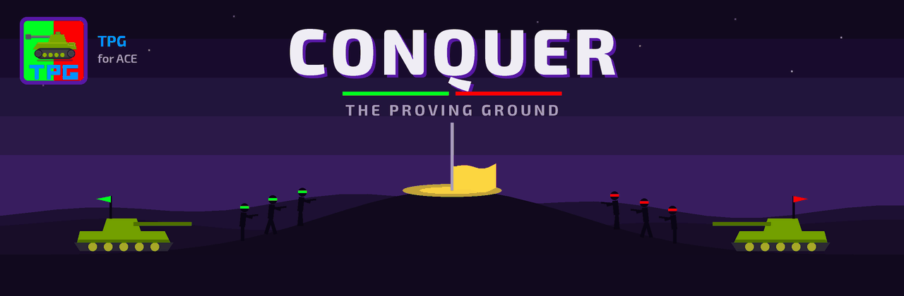
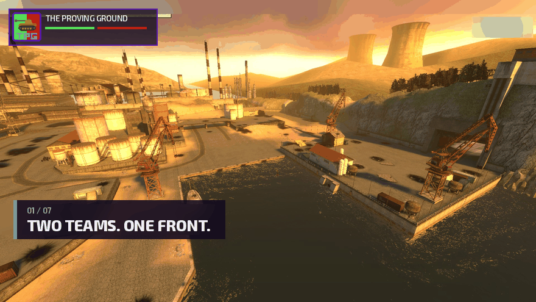

# The Proving Ground
A gamemode heavily inspired by the Baiknor combined arms gamemode, but for ACE

On the Workshop: [The Proving Ground](https://steamcommunity.com/sharedfiles/filedetails/?id=3820591474)
and [TPG E2 & Starfall Team Functions](https://steamcommunity.com/sharedfiles/filedetails/?id=3820591473).



To install:
Garrysmod/garrysmod/gamemodes

Requires ACE (Armored Combat Extended) installed under `garrysmod/addons/`. On
startup TPG checks for ACE/CFW and prints a warning to the server console if
either is missing (see `TPG.Config.ValidateACE()` in `gamemode/config/sh_config.lua`).

## Workshop build

`python tools/build_gma.py` packs the gamemode into `build/theprovingground.gma` for upload.
Title, type and tags come from `addon.json`. Running gmad on the repo directly doesn't work: a
gamemode has to sit under `gamemodes/theprovingground/` inside a .gma, so the script stages it
that way first.

Upload a new build of an existing item with
`gmpublish update -id 3820591474 -addon build/theprovingground.gma -changes "..."`
(3820591473 for tpg_e2sf, packed with `gmad create -folder addons/tpg_e2sf`).

gmpublish only sets the file and a square JPG icon. `python tools/workshop_page.py tpg` (or
`tpg_e2sf`) sets the rest of the page through Steam's API, with Steam running: the animated
preview, the description from `workshop/*.bbcode`, the gallery and the required items. It leaves
visibility alone.

## README media

`media/header.gif` is drawn by `python tools/media/make_header.py`, from the HUD palette, Exo 2
and `icon512.png`. `media/gameplay.gif` is built by `python tools/media/make_gameplay.py <steam
screenshot folder>`, which blurs out chat, names and overlays before anything else.
`media/e2sf.gif` is drawn by `python tools/media/make_e2sf.py` in the header's style.
`media/workshop/` holds the Workshop previews and the tpg_e2sf logo, drawn by
`python tools/media/make_workshop.py`. The gallery stills come from
`make_gameplay.py <steam screenshot folder> --stills build/workshop`. All of these need Pillow.

## E2 and Starfall functions

The `tpg*` chip functions (team roster, loadouts, teammate checks) live in a separate addon,
[tpg_e2sf](https://github.com/ACE-Project-Team/tpg_e2sf). **TPG servers need it installed**,
because TPG has no chip functions of its own. The same addon also works in plain sandbox: there
it adds stand-in teams (`tpg_test_team`), so you can build and test chips before joining a
match. Its README lists every function.


GMod only loads Wire and Starfall extensions from a real addon under `garrysmod/addons/`, never
from inside a gamemode. Install it there like any other addon. On startup TPG prints a warning
to the server console if it's missing (`TPG.Config.ValidateE2SFSandbox()` in
`gamemode/config/sh_config.lua`).

For development this repo carries it as a submodule at `addons/tpg_e2sf`. Clone with
`git clone --recurse-submodules`, or run `git submodule update --init` in an existing clone,
then link the folder into `garrysmod/addons/` once per machine so the copy you edit is the one
the game loads:

```powershell
New-Item -ItemType Junction -Path "<garrysmod>\addons\tpg_e2sf" -Target "<garrysmod>\gamemodes\theprovingground\addons\tpg_e2sf"
```

```bash
ln -s "<garrysmod>/gamemodes/theprovingground/addons/tpg_e2sf" "<garrysmod>/addons/tpg_e2sf"
```

The addon is its own repository: commit and push changes to it there, then commit the updated
submodule here. Anything it reads from TPG is pinned by `tests/test_e2sf_contract.lua`.

WIP
